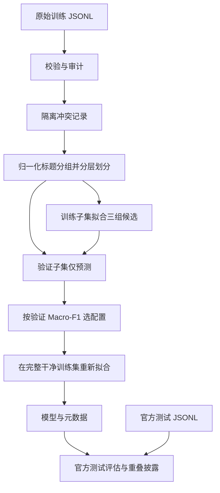
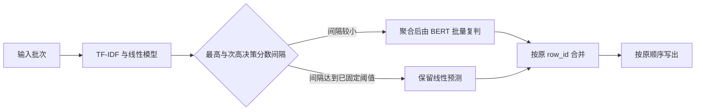

# 商品标题分类技术报告

记录日期：2026-10-23。本报告对应 README 中的分析因素、框架选择、流程优化、迭代记录、实现缺陷及深度优化建议。

当前实现为 **字符级 TF-IDF + LinearSVC**。用户确认本轮只补齐报告；BERT 微调、TextCNN 和混合方案均为设计或候选，未实现、未训练，不具有本项目的实测成绩，也不能据此声称已经完成微调或混合方案加分项。现有开发运行数据用于说明实现，验收仍以用户在终端实际运行的结果为准。

## 1. 需求、交付与证据

| 题目要求 | 本项目对应内容 | 状态与证据 |
| --- | --- | --- |
| 商品标题十分类 | 本地标题与标签校验、TF-IDF + LinearSVC | 已实现；[数据模块](../src/dataset/__init__.py)、[训练模块](../src/modeling.py) |
| 千万量级预测场景 | 流式读取、稀疏批量推理、分批写出、性能测量入口 | 已实现处理方式；未实际运行千万条；[推理模块](../src/inference.py) |
| 分析因素与框架选择原因 | 数据特点、候选路线比较、技术栈取舍 | 本报告第 2～4 节 |
| 流程优化分析 | 已做措施、测量范围、缺少的消融证据 | 本报告第 5 节 |
| 指标与过程记录 | 三组同一路线参数实验、验证选择、最终拟合、独立测试 | [结果快照](RESULTS.md)、[迭代记录](ITERATIONS.md)及运行产物 |
| 大模型微调、混合方案 | 中文 BERT 微调与线性模型分级路由设计 | 仅设计，见第 7 节；无新增模型代码或实验 |
| 缺陷与优化方向 | 信息不足、标签噪声、泛化边界、优先级及判断标准 | 第 6、8 节 |
| 可复现与验收 | 锁文件、数据摘要、划分清单、脚本 | [运行说明](IMPLEMENTATION.md)、[验收脚本](../scripts/verify.ps1) |

当前 Python 交付采用 `.py` + Markdown 过程记录。训练、评估、预测均有命令入口。运行产物默认位于 `artifacts/`，该目录受 `.gitignore` 排除；通过 Fork 链接交付时，读者先按运行说明生成产物，通过 ZIP 交付时可附带对应模型与报告。仅有代码仓库不代表其中包含被忽略的二进制模型。

## 2. 分析因素：从数据和使用场景出发

方案一：字符级 TF-IDF＋线性分类模型
**做法：**提取标题中的连续字符片段，例如“茉莉花茶”中的“茉莉”“花茶”，转成 TF-IDF 稀疏向量，使用 LinearSVC 完成十分类。这类文本特征可以与线性分类器组合使用。技术依据
优势：
- 对“牙膏”“方便面”“奶茶”等明确品类片段有直接的利用能力。
- CPU 即可训练和预测，开发、部署和复现相对简单。
- 可以查看各类对应的特征权重，便于分析分类依据。
劣势：
- 对同义表达、隐含语义和较远距离的上下文关系表达有限。
- 容易依赖品牌等数据中的偶然关联，需要检查泛化表现。
- 字符片段范围过大时，词表和内存开销会增加。
**项目定位：**作为低成本基线，衡量复杂模型带来的收益是否值得。

方案二：中文 BERT 微调
**做法：**使用中文 BERT 预训练权重，在其上添加十分类输出层，使用商品标题和标签进行全参数微调。BERT 通过预训练学习上下文表示，并支持添加输出层进行下游任务微调。原始论文
优势：
- 能利用预训练语言知识，对上下文和不同表达方式有更强的建模能力。
- 对缺少直接品类关键词的标题，具有值得验证的泛化潜力。
- 可以完整展示微调、模型选择和误差分析过程，符合题目的加分方向。
劣势：
- 训练和推理计算开销较大，实际训练建议使用 GPU。
- 千万级预测需要重点测量吞吐、显存和总处理时间。
- 商品标题与预训练语料存在差异，小数据或标签噪声下仍可能过拟合，不能保证优于简单模型。
**项目定位：**作为你倾向的主方案，重点验证效果提升及其计算成本。

方案三：字符级 TextCNN
**做法：**将标题转成字符序列，经过字符嵌入、不同宽度的卷积、最大池化和分类层。借鉴 TextCNN 的句子分类结构，本项目采用字符输入以适配中文标题。原始论文
优势：
- 卷积可以学习不同长度的局部字符组合，适合检验短标题中的局部模式。
- 小型网络的结构通常比标准 BERT 轻，适合作为预测成本的折中候选。
- 可以与 BERT 共用 PyTorch 技术栈，方便统一训练和评估流程。
劣势：
- 若字符嵌入从头训练，更依赖本项目的标注数据量。
- 对较远距离关系和复杂语义的表达能力有限。
- 数据较少时，可能同时面临训练不稳定、效果不如 TF-IDF 的问题。
**项目定位：**检验轻量神经网络能否在效果与预测成本之间取得合适的平衡。

查看 data 目录后，我建议首版选择字符级 TF-IDF＋LinearSVC。这份数据的短标题和局部品类词特征很明显，适合先用该方案完成分类与千万级预测。最终效果仍需实验确认。

选择它主要有三个原因：
1. 局部字符片段已经包含很强的分类信号。
   训练集中，即饮茶有 1,774/1,777 条包含“茶”，牙膏有 2,310/2,350 条包含“牙膏”，方便面有 1,169/1,180 条包含“面”。字符片段还能覆盖“牛乳茶”“压片糖”“果汁软糖”等表达。注意，这些是关键词覆盖率，不是模型准确率。
2. 与千万级预测的成本要求比较匹配。
   TF-IDF＋LinearSVC 可以使用 CPU 和稀疏矩阵进行批量预测，作为首版的开发、部署成本较低。具体吞吐和处理千万条数据的时间，需要在实际机器上测量。
3. 目前没有数据证据证明更复杂的模型值得优先投入。
   BERT 值得用于验证困难类别是否得到改善，但需要同时衡量效果提升和推理成本。字符级 TextCNN 需要学习字符表示及卷积特征，在当前数据上未必比 TF-IDF 更好，增加的训练与调参工作也需要收益支撑。
数据中还有两类问题，会影响任何模型：
- 标题信息与标签存在局限。 冷藏果汁的 646 条训练样本中，只有 32 条明确包含“冷藏”。此外，“令德堂冷榨芒果汁1.5L”被分别标为[非冷藏果汁 (line 5894)](D:/PythonProject/shoppingitemclassify/data/train.jsonl:5894)和[冷藏果汁 (line 11174)](D:/PythonProject/shoppingitemclassify/data/train.jsonl:11174)。相同输入的标签冲突无法靠更换模型消除。
- 重复数据可能影响评估。 训练集有 232 条重复标题的额外记录；标题归一化后，训练集与测试集重叠 85 个标题，涉及 86 条测试记录，约占测试集的 2.15%。后续应按标题分组划分验证集，并披露官方测试集的重叠情况。
因此，我的选型建议是：TF-IDF＋LinearSVC 作为首个交付方案，BERT 作为后续效果对照候选。 使用 Macro-F1 和各类召回率评估，重点观察冷藏／非冷藏果汁、软糖／硬糖等易混类别。


### 2.1 数据规模与标题形态

原始训练集 15,997 条、测试集 4,003 条，字段只有 `product_name` 和 `category`。训练标题长度中位数 14 字符，95% 不超过 21 字符，最长 34 字符。任务以短文本中的品牌、品类、口味和规格组合为主，因而首先考察局部字符片段能否完成分类。

训练数据中，即饮茶 1,777 条有 1,774 条含“茶”，牙膏 2,350 条有 2,310 条含“牙膏”，方便面 1,180 条有 1,169 条含“面”。这只是输入特征覆盖证据，不是这些类别的分类准确率；例如“牙膏”标题也可能包含“茶”味，必须让分类器结合多个片段学习，不能按单个词直接指定标签。

字符输入省去独立中文分词词典的维护，可以同时表达“乳茶”“果汁”“软糖”等片段及规格组合。原始数字、标点和规格没有被直接删除，因为它们也可能提供有效信号。是否应该删除规格，需要单独对照实验，目前没有这项实验。

### 2.2 类别不均衡与质量问题

训练类别数量为 564～2,782，最大约为最小的 4.93 倍。选型需要同时观察整体效果与少数类表现，因此以固定十类的 Macro-F1 选模，另外输出 Accuracy、Weighted-F1、每类指标和混淆矩阵；类别权重作为实际对照变量之一。

训练集有 232 条归一化重复标题的额外记录，且“令德堂冷榨芒果汁1.5L”两条记录存在冷藏/非冷藏标签冲突。按用户决定，训练隔离两条冲突记录，保留原始数据并写审计；一致标签的重复记录保留，划分验证集时按标题分组。

原始训练测试间有 85 个归一化重叠标题，涉及 86 条测试记录。官方测试保持完整，另外披露未见标题子集，避免把重叠样本带来的收益隐藏在总体指标中。相同品牌、系列和仅规格不同的近似标题仍可能跨集合，当前划分不等同于跨品牌泛化测试。

### 2.3 标题信息是否足够

646 条原始冷藏果汁训练标题中，仅 32 条明确包含“冷藏”。“冷榨”“NFC”与储存条件不能简单画等号。错误可能来自输入信息不足、标签质量或模型能力，需要分别核查，换模型不保证消除这些问题。

### 2.4 千万量级指预测量

本项目的训练集只有约 1.6 万条，“千万量级”描述待预测数据量。主要工程约束是模型能否重复使用、输入输出能否分批处理、每条预测的成本和峰值内存，而不是默认引入分布式训练。最终选型应结合分类效果与目标机器上包含文件写出的总成本。

## 3. 三种候选方案及选择

| 维度 | 字符 TF-IDF + LinearSVC | 中文 BERT 微调 | 字符 TextCNN |
| --- | --- | --- | --- |
| 结构 | 连续字符片段 → 稀疏 TF-IDF → 十类线性判别 | 分词 → 预训练上下文表示 → 十类分类头 | 字符嵌入 → 多窗口卷积 → 最大池化 → 分类 |
| 潜在优势 | 品类片段直接、CPU 可用、训练部署简单、可检查特征权重 | 利用预训练信息，有更强的上下文建模潜力 | 学习局部组合，小型网络可作为神经模型成本折中候选 |
| 主要代价或缺陷 | 隐含语义与较远关系表达有限，可能依赖品牌相关性；词表也占内存 | 训练和推理计算成本较高；噪声和领域差异仍会影响效果 | 从头学习嵌入时依赖标注量，需要额外训练和调参，未必优于线性模型 |
| 千万级关注点 | 特征提取、词表大小、批大小、文件 I/O | 分词开销、GPU 批量吞吐、显存与总调用比例 | 网络规模、批量推理效率、字符词表 |
| 本项目实际状态 | 已训练、评估及提供验收入口 | 未实现、未实测 | 未实现、未实测 |

选用线性模型的初始依据是短标题、强局部信号及规模预测成本；后续验证结果支持其作为首版候选，但不能证明它优于未实测的 BERT 或 TextCNN。BERT 的预训练与分类微调机制见 [BERT 原始论文](https://aclanthology.org/N19-1423/)；TextCNN 的句子分类结构见 [原始论文](https://aclanthology.org/D14-1181/)，本项目讨论的字符输入是面向中文标题的候选改造。

## 4. 框架与实现选择原因

| 选择 | 本项目的原因 | 实际作用或限制 |
| --- | --- | --- |
| Python + uv | 与现有仓库和数据处理方式一致，便于用同一命令复现 | `uv.lock` 固定解析版本；首次同步仍需安装依赖 |
| scikit-learn | 提供字符 TF-IDF、线性分类、分层划分和统一指标，减少自定义数值实现 | 不因此保证效果；具体参数仍要由验证数据选择 |
| Pipeline | 把归一化、向量化与分类组合到统一拟合/预测流程 | 训练侧 `fit` 后对验证侧仅 `predict`，避免独立预处理时误在全数据拟合 IDF；Pipeline 本身不能阻止调用方误用数据 |
| 字符 2～4 gram | 用短片段表达品类和局部组合，适合当前短标题形态 | 此范围是首版配置，尚无 n-gram 消融实验，不能称其最优 |
| LinearSVC | 支持稀疏、多类输入，适合作为该特征表示的监督分类器 | 决策分数不是概率；当前无概率校准或拒识机制 |
| NumPy / SciPy 稀疏表示 | 批量向量化后保留稀疏结构，不转为每条均含十万维的稠密向量 | 分类器内部仍可能产生拷贝；不能声称整个模型或所有计算均为 float32 |
| joblib | 一次保存、加载整个 Pipeline，维持归一化与词表一致 | 是本地 Python 模型格式，加载应使用可信模型并匹配依赖版本 |
| pandas / psutil | pandas 用于兼容数据预览；psutil 用于进程 RSS 与机器信息 | 大文件预测不使用全量 DataFrame；RSS 是采样进程内存，包含运行时及依赖 |

[Pipeline 文档](https://scikit-learn.org/stable/modules/compose.html#pipeline-chaining-estimators)解释了变换与模型串联；[LinearSVC 文档](https://scikit-learn.org/stable/modules/generated/sklearn.svm.LinearSVC.html)说明其稀疏输入、多类处理及决策分数含义。以上框架选型是结合当前任务的工程判断，不是来自文档的本数据集性能结论。

## 5. 实现流程与流程优化分析

### 5.1 训练与评估



三组参数是预先固定、使用相同划分的对照，均采用字符 2～4 gram：

| 候选 | 验证 Macro-F1 | 验证冷藏果汁召回率 | 决策 |
| --- | ---: | ---: | --- |
| C=1，无类别权重 | 97.1692% | 79.6875% | 作为参数对照 |
| C=3，无类别权重 | 97.5423% | 83.5938% | Macro-F1 略低于最终配置 |
| C=1，balanced | 97.5874% | 86.7188% | 按预定规则选择 |

balanced 相对 C=1 无权重的验证 Macro-F1 增加约 0.4182 个百分点；与 C=3 的差距仅约 0.0451 个百分点，单次划分不能证明统计显著性。选定后在 15,995 条可用训练记录上重新拟合；开发运行的官方测试 Macro-F1 为 97.8283%、Accuracy 为 98.3263%，未见标题子集 Macro-F1 为 97.7623%。完整指标、配置和错误明细见 [RESULTS.md](RESULTS.md)。

### 5.2 已做措施与证据边界

| 措施 | 解决的问题 | 现有证据 | 还不能得出的结论 |
| --- | --- | --- | --- |
| 单进程中加载一次模型，分批读取、预测、写出 | 避免逐条加载模型和一次性保存全部输入 | 推理实现及真实输入运行；两种预测批大小的输出哈希相同 | 未做逐条加载对照，不能给出提速倍数；没有实际千万条运行证据 |
| TF-IDF 批量稀疏输入，矩阵使用 float32 | 控制批内特征表示的内存开销 | 实现配置、模型元数据、进程 RSS 采样 | 未做 float64 对照，不能声称整体内存减少一半 |
| 最多 100,000 个特征 | 给模型词表规模设置上限 | 最终词表达到上限，模型文件约 10.97 MiB | 未做词表上限消融，可能丢失有用稀有片段，不能称为最优上限 |
| 256 / 1024 / 4096 批大小对比 | 观察批大小的性能和内存影响 | 每组各处理 15,997 条的报告 | 每组仅约 0.3～0.4 秒，不能确认稳定排名或最优批大小 |
| 分组划分、审计和数据指纹 | 提高评估可信度及复现能力 | 划分清单、冲突隔离明细、SHA256、功能测试 | 没有消除近似 SKU 或品牌泄漏，也不直接增加模型吞吐 |
| 输出临时文件完成后替换、严格 CSV 解析、输入输出路径检查 | 避免坏输入导致不完整结果或覆盖输入 | 对应功能测试、真实批量流程 | 当前没有断点续跑；临时输出还需要磁盘空间 |

性能命令包含输入解析、特征提取和分类，排除模型加载与结果写盘；预测命令计时包含写出、排除模型加载。两者不能混用。RSS 是整个进程采样峰值，不能当作模型文件大小或精确的瞬时峰值。

早期 [RESULTS.md](RESULTS.md) 的批大小 4096 快照约为 54,965 条/秒；本轮只读看到的当前 JSON 约为 40,806 条/秒，其他批大小的排名也变化。分类指标和数据摘要一致，但这些文件可能被重新运行覆盖，不能据此推断新增了模型迭代或优化。应以各份产物自己的环境、样本数、计时范围和版本为准，不能拼接不同时次的数字作收益对比。

## 6. 实现缺陷与结果限制

| 问题 | 影响 | 当前处理与剩余限制 |
| --- | --- | --- |
| 储存条件等属性缺失、标签冲突 | 同一输入可能无法确定唯一标签 | 隔离已发现的训练冲突；未审核所有标签，未增加额外属性 |
| 冷藏果汁与糖果边界 | 少数类短板可能被总体 Accuracy 掩盖 | 开发测试中冷藏果汁 Recall=83.75%；果汁冷藏边界与软/硬糖混淆占 55/67 条错误 |
| 线性片段特征 | 可能错用品牌关联，复杂上下文表示有限 | 已保留错误案例；尚未做特征归因或跨品牌测试 |
| 一次验证划分 | 小幅参数差距可能受样本划分影响 | 种子与分组索引可复现；未进行多种子或分组交叉验证 |
| 测试标题重叠和近似 SKU | 总体指标可能偏乐观 | 完整测试与未见标题子集都披露；没有独立跨来源/时间测试集 |
| 固定十类、无拒识 | 任何非空标题都会被归到十类之一 | 未提供未知品类检测或可靠概率，不能把分类分数当业务置信度 |
| 规模测量不足 | 小文件短测不能验证长期吞吐、写盘或中断恢复能力 | 提供基准入口和明确外推限制；无实际千万条、故障恢复或长期运行证据 |
| 审计/训练/评估与预测的内存策略不同 | 不能把流式预测能力推广到所有命令 | 审计、训练和测试评估仍加载各自数据集；它们针对当前约 2 万条标注数据 |
| 复现产物会被同目录重跑覆盖 | 无法仅凭当前耗时重建每次运行历史 | 留存本次文档快照；后续运行应使用独立输出目录并保存配置和日志 |

本轮只补报告，不修复或扩展这些限制。尚未收到用户明确的实际验收结论，开发自检结果不替代用户验收。

## 7. BERT 微调与混合方案设计（未实施）

### 7.1 中文 BERT 微调设计

设计目标是检验预训练上下文表示能否改善易混类别，并量化额外成本。采用标准中文 BERT 加十分类头、使用预训练权重做监督微调；这属于预训练语言模型微调，不等同于从零预训练，也不包含生成式 LLM 的指令微调。若后续希望以生成式大模型争取加分，需要另行明确模型类型。

后续实验应固定模型权重版本、tokenizer、标签映射、训练数据摘要和划分清单。用于与现有线性模型比较时复用同一标题分组划分，只在训练侧更新模型，验证侧选 checkpoint。标题字符长度不等于 tokenizer 长度，截断长度应通过训练标题的分词长度统计确定；批大小、混合精度和梯度累积由实际硬件决定。

先验证少量样本的训练与保存加载链路，再按预先限定的学习率/训练轮数范围进行实验，保留每轮损失、验证 Macro-F1、各类召回率及所选 checkpoint。效果比较和性能比较均需单独报告；GPU 吞吐不能直接与 CPU 吞吐混为同资源结论。

判断是否采用的证据应包括：相同验证范围的 Macro-F1、冷藏果汁与糖果类别指标、训练耗时、模型大小、实际机器的吞吐、RSS/显存和包含输出写盘的总耗时。没有实测结果前不填写 BERT 准确率、提升幅度或处理时限。

### 7.2 TF-IDF 与 BERT 分级混合设计



设线性模型最高、次高决策分数为 `s1`、`s2`，使用 `margin = s1 - s2` 作为待验证的路由依据，低于阈值时送 BERT。LinearSVC 的分数不是概率，不能将 `margin=0.9` 解释为 90% 正确率，也不能直接与 BERT softmax 加权平均。

门控实验必须单独设计数据隔离：在训练文件内部按标题组固定模型拟合集、模型选择集和门控选择集，所有参照模型使用相同的新划分；新划分的成绩单独报告，不能直接冒充此前实验的提升。两模型冻结后在门控集上选择阈值，官方测试不参与。若最终重新拟合导致分数尺度改变，旧阈值不能直接沿用，应重新获得独立门控数据或预先设计分组交叉拟合流程。两个阶段都不能使用在其自身训练标题上得到的分数评价泛化。

阈值比较同时记录路由比例 `r`、Macro-F1、冷藏果汁召回率、BERT 修正的错误数、把原正确结果改错的数量及端到端吞吐。高分错误可能绕过 BERT，低分也不保证 BERT 更准，所以分级路由不是自动获得效果提升的规则。

顺序执行时，可用以下成本模型解释取舍，所有项均需实测：

```text
每条平均成本 ≈ 线性预测成本 + 门控成本 + r × BERT复判成本 + 输入输出成本
```

路由减少的是 BERT 调用比例；两个模型同时常驻时，内存可能更高。聚合困难样本有利于批量复判，但需要保存行号、恢复顺序并考虑小批等待成本。比较对象应同时包含纯线性、纯 BERT 和混合三种推理方式；应测试不路由与全部路由的边界。是否接受某个效果/成本组合由决策者确定，本报告不假定硬性阈值。

## 8. 深度优化建议与优先级（均未新增实验）

| 优先级 | 要回答的问题 | 建议的后续实验或分析 | 判断依据与停止条件 |
| --- | --- | --- | --- |
| P0 数据边界 | 标签是否一致，标题是否提供足够信息 | 在训练/验证数据中人工核查冷藏属性及糖果分类；如有商品属性可另行评估引入 | 形成审核记录与修订版本；不能仅按已查看的测试错误修改标签，也不能用模型猜测代替真实属性 |
| P1 泛化稳定性 | 当前指标是否依赖品牌和一次划分 | 分组多种子或交叉验证；有可靠品牌/时间/来源字段时另建隔离测试 | 报告均值、波动及每类支持数；不存在这些字段时不声称完成对应隔离 |
| P1 特征消融 | 字符范围和十万词表是否合适 | 在训练/验证范围小规模对照 n-gram、词表上限、规格保留与去除 | 同时比较 Macro-F1、冷藏召回、模型大小和吞吐；没有稳定收益则保留较简单配置 |
| P2 预训练模型 | BERT 是否改善局部特征难例 | 按第 7.1 节固定协议微调并比较 | 提升须在独立于训练的数据上出现，并与计算成本一起决策 |
| P2 混合路由 | 能否用少量 BERT 调用获得合理收益 | 按第 7.2 节选择阈值并比较效果/路由比例/总耗时 | 若修正收益被改错和路由成本抵消，则不采用；不以调用比例低单独判定成功 |
| P3 压缩与并发 | 真正瓶颈在模型、特征还是 I/O | 先做较长时间剖析；只有采用 BERT 后才评估其量化/蒸馏，CPU 路线视瓶颈评估分块并发 | 压缩前后逐类指标与成本对照；并发考虑模型复制、序列化和线程过量，未实测不承诺加速 |
| P3 规模与恢复 | 千万条长期运行是否可靠 | 在目标机器、真实标题分布上测包含写盘的长任务；如有需求再设计分片与断点续跑 | 总行数、顺序、输出完整性、磁盘、峰值资源及失败恢复；重复小数据只能作为工程压测，不能当新增分类评估样本 |

官方测试结果已被查看，后续模型选择继续限制在训练/验证范围。若目标是报告新模型的独立泛化能力，应争取额外未使用的新数据或预先封存的评估集合，并清楚区分公开测试参考与新增独立证据。

## 9. 复现入口与记录保留

在项目根目录执行已有脚本：

```powershell
.\scripts\verify.ps1
```

它运行功能测试、数据审计、三组训练实验、最终评估、两种批大小预测一致性检查及三组性能测量。数据和模型指标由脚本实际生成；本轮文档更新没有重新训练或运行测试。若要保留另一轮产物，可使用脚本已有的输出参数：

```powershell
.\scripts\verify.ps1 -OutputDir artifacts/review-run-01
```

每次使用不同目录，并连同 `metadata.json`、`experiments.json`、`split_manifest.json`、训练审计、验证/测试指标、错误样本及性能报告保存。BERT 和混合方案没有可运行入口，不能从该脚本取得它们的成绩。详细操作见 [IMPLEMENTATION.md](IMPLEMENTATION.md)，真实决策过程见 [ITERATIONS.md](ITERATIONS.md)。
